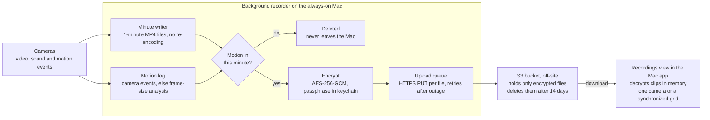

# Camera Recording Plan

19 November 2026

A background recorder on the always-on Mac records every camera during a daily window and keeps only the minutes with motion. Kept minutes are encrypted, uploaded to an S3-compatible bucket and deleted there after a retention period, 14 days by default. The Mac app plays them back, one camera alone or all cameras in a synchronized grid.

## How it works

Every minute is written to disk first and judged 10 s after it closes. A minute without motion is deleted on the Mac; a minute with motion is encrypted, uploaded and played back from the bucket.

## Decisions

These choices are settled and the rest of the plan builds on them.

| Topic | Decision |
| --- | --- |
| Recorder host | The always-on Mac, as a background process started at login |
| What is recorded | Every configured camera, during one daily time window |
| What is kept | Only minutes with motion, plus padding before and after |
| What is recorded with it | Sound, on by default |
| Off-site storage | Any S3-compatible bucket; endpoint, region and bucket are set in Settings |
| Retention | 14 days by default, chosen once in storage setup together with the keys, deleted by the bucket itself |
| Encryption | On the Mac before upload, AES-256-GCM |
| Passphrase | Stored in the login keychain and shown once at setup, so a second copy can be saved |
| Signing | The recorder is the app, so it carries the app's signing identity |
| Settings scope | One set of recording settings for all cameras |
| Playback | In the Mac app: one camera, or all cameras in a synchronized grid |

## Recording

The recorder is the app itself, started without a window by a LaunchAgent, with its own connection to each camera.

- **Process:** it runs while the app is closed. The Mac must be logged in, and the recorder keeps it from sleeping during the window.
- **Window:** one start and one stop time in the Mac's local time, which may wrap over midnight. Outside the window the recorder logs out and pulls no stream.
- **Minute files:** the H.264 or H.265 video and the AAC sound go into an MP4 as they arrive, without re-encoding. Files are cut on the wall-clock minute for all cameras, at the first key frame after each `:00`.
- **Motion signal:** the camera's own detector, pushed over Baichuan (message ids 31 and 33 according to Neolink and reolink_aio). A camera that pushes no events is judged by the size of its predicted frames, with no decoding.
- **Keep rule:** a minute is kept if motion, widened by 10 s before and 20 s after, touches it. The decision falls 10 s after the minute closes; every other minute is deleted.
- **Volume:** at an assumed 2 Mbit/s a kept minute is about 15 MB. Thirty motion minutes a day are about 0.45 GB per camera, against 10.8 GB for 12 hours of continuous recording.

## Storage and retention

Each kept minute is uploaded once over HTTPS, and the bucket itself deletes it when the retention period ends.

- **Upload:** one signed HTTPS PUT per file, written with URLSession and CryptoKit, so the project stays free of third-party code. The queue survives restarts and catches up after an internet outage.
- **Layout:** `camera-id/2026-11-19/HHmmssZ_60s.mp4.enc`, with times in UTC. One encrypted index per day lists every camera's files and motion times, so a day's timeline needs one request.
- **Provider:** any S3-compatible service. Endpoint, region and bucket are entered in Settings, and nothing in the code is tied to one provider.
- **Retention:** a lifecycle rule on the bucket deletes objects after the retention period, 14 days by default, even if the Mac is off or stolen. The recorder's key can upload but not delete; the viewer uses a read-only key.
- **Storage setup:** the retention period is chosen in the same step as the keys. Setup writes the lifecycle rule with a setup key that may change it; that key is used once and not stored. Afterwards the period is shown read-only. Changing it means running storage setup again with new keys.
- **Local cache:** the Mac keeps the encrypted files for 2 days for fast playback, then removes them.

## Encryption

Clips and the day index are encrypted on the Mac, so the storage provider holds only ciphertext.

- **What is sealed:** every clip and every day index, with AES-256-GCM, before upload. The local cache holds the sealed files too, and playback decrypts in memory. Only the minute being recorded is on disk in the clear.
- **Keys:** a random data key encrypts the files. It is wrapped with a key derived from the passphrase and stored in the bucket as a small key file. Changing the passphrase re-wraps that key and leaves the recordings untouched.
- **Passphrase:** entered or generated in Settings and stored in the login keychain, next to the camera passwords. The recorder and the viewer both read it from there. A second Mac needs it entered once.
- **What the provider still sees:** file names, sizes and upload times. That shows when and how much was recorded, not what.
- **Second copy:** if this Mac is stolen, the keychain goes with it and the off-site recordings cannot be decrypted. Setup therefore shows the passphrase once, with a prompt to save it in a password manager.

## Playback

A Recordings view in the Mac app plays clips from the local cache or the bucket, one camera alone or all cameras in step.

- **Single camera:** a camera and day picker and a 24-hour timeline, with kept minutes as blocks and motion marked. Consecutive minutes play seamlessly, gaps are skipped, and a clip can be saved.
- **Grid:** the same single/grid switch as the live view. One playhead in wall-clock time drives every camera's player, so play, pause, scrub and speed apply to all.
- **Visible cameras:** only cameras with a kept minute under the playhead get a tile, and the grid re-flows as they come and go. Cameras keep their Settings order, and tiles change only at minute boundaries.
- **Gaps:** when no camera has content, the playhead jumps to the next moment any camera does.
- **Timeline in the grid:** one lane per camera, stacked, under the shared playhead.
- **Tiles:** clicking one opens that camera alone at the same timestamp. One camera is audible, as in the live grid.
- **Sync accuracy:** cameras line up to within about a second, not frame-exact, because each stream arrives with its own delay.
- **From any Mac:** the app, the bucket key and the passphrase are enough to play the recordings, also while the recording Mac is off.

## Settings

All recording settings live in one Recording tab and apply to every camera.

| Setting | Default |
| --- | --- |
| Record all cameras | Off |
| Start time, stop time | None |
| Stream (Clear or Fluent) | Clear |
| Audio | On |
| Keep (motion only or everything) | Motion only |
| Segment length | 60 s |
| Padding before and after motion | 10 s and 20 s |
| Local cache | 2 days |
| Endpoint, region, bucket | None, entered in storage setup |
| Access keys and passphrase | None, entered in storage setup, stored in the keychain |
| Retention | 14 days, chosen in storage setup, read-only afterwards |

The motion source is not a setting: the recorder picks it per camera, as described under Recording.

## Build phases

Four phases, each usable on its own. Phase 1 decides whether the cameras' own motion events can be relied on.

| Phase | Builds | Done when | Status |
| --- | --- | --- | --- |
| 1. Proof on the command line | Motion events in the `Baichuan` library and `bctool events`. The MP4 minute writer and `bctool record`. The sample-buffer code moves out of `VideoRenderer.swift` into shared code. | Minute files from the E1 (H.264) and the fixed camera (H.265) play in QuickTime with sound. Motion events are confirmed or ruled out for both. | Not started |
| 2. Recorder and settings | The Recording tab with the global settings. The daily window. The motion log and keep rule, with the frame-size fallback. The local folder and its cleanup. Headless mode, the LaunchAgent and stable code signing. | With the app closed, one night's window leaves only motion minutes on disk for every camera, across a camera restart and a Mac sleep. | Not started |
| 3. Encryption and upload | The key file and the passphrase in the keychain. AES-256-GCM sealing. The S3 client, the upload queue, the day index and storage setup, which writes the lifecycle rule. | Kept minutes reach the bucket encrypted within 2 minutes. A one-hour outage is caught up. A downloaded file opens only with the passphrase. | Not started |
| 4. Playback | The Recordings view with the timeline for one camera, then the synchronized grid. | A second Mac plays yesterday's recordings with only the bucket key and the passphrase. The grid keeps cameras within about a second. | Not started |

## Risks

Six risks are known, and the first three are checked before most of the code is written.

| Risk | How it is checked | Fallback |
| --- | --- | --- |
| The cameras do not push motion events over Baichuan | `bctool events` on both camera models, phase 1 | Frame-size analysis for that camera, chosen automatically |
| A camera refuses the viewer and the recorder at the same time | Live view and `bctool record` together, phase 1 | The recorder takes priority during the window, or the two use different streams |
| The background process cannot read the keychain when the build falls back to an ad-hoc signature, which changes with every build | Run the LaunchAgent after a rebuild, phase 2 | Build with the app's Apple Development certificate, so the recorder's identity stays stable |
| Grid playback of several full-resolution streams is too heavy to decode or download | Measure with all cameras, including the 4512×2512 one, phase 4 | Also record the Fluent stream and use it in the grid |
| The configured provider has no lifecycle rules | Provider documentation, when a bucket is configured | The recorder deletes expired objects itself, with a key that may delete |
| The passphrase is lost with the Mac | Cannot be tested | A second copy in a password manager, shown once at setup |

## Open questions

None. The storage provider, retention, sound, signing identity and the passphrase copy are settled under Decisions.
